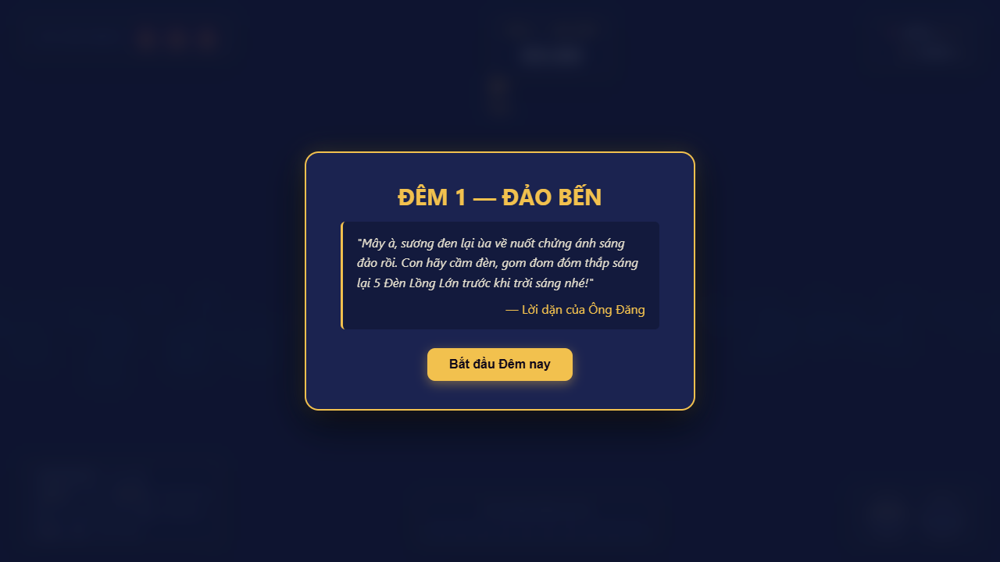
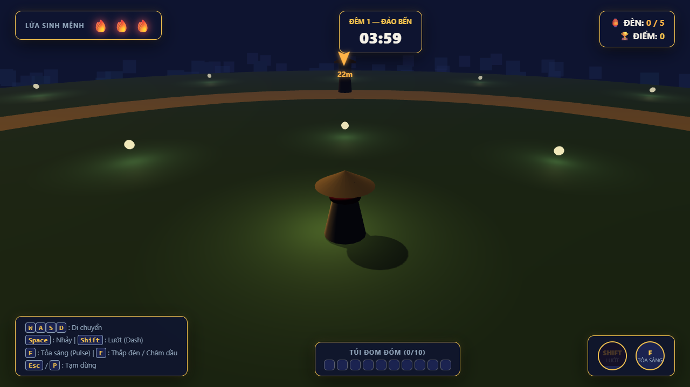
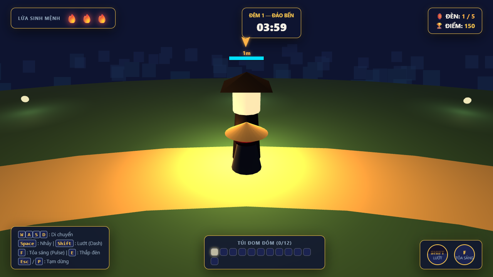
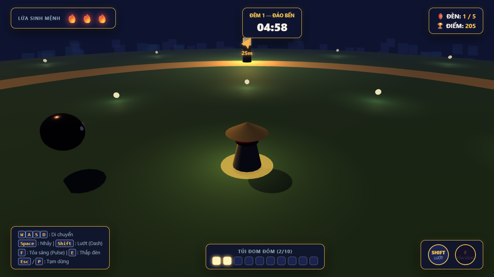

# Đảo Đèn Lồng (Lantern Island) — AI SDLC Day 12

> **Tác giả:** Trần Quang Nam (MSSV: 2A202603516)  
> **Dự án:** Game 3D góc nhìn thứ ba & Chế độ Headless Test Contract v1.3  
> **Bản phát hành:** Tag `phase-4` | GitHub Release `v1.0.0` (Ticket-04 — "Bình minh: phát hành v1.0.0")

---

## 🎬 Video Demo Sản Phẩm (Dưới 5 Phút)

> 📹 **Thời lượng:** `03:36` (< 5 phút — đáp ứng tiêu chí Rubric G & SUBMISSION.md)  
> 🔗 **Đường dẫn xem & tải video:**  
> - **Tải / xem trực tiếp trong repository:** [docs/demo/game.mp4](docs/demo/game.mp4) *(hoặc [public/game.mp4](public/game.mp4))*  
> - **Đính kèm GitHub Release v1.0.0:** [Tải tại GitHub Release v1.0.0](https://github.com/wgnamlabs/K5-L3A-DAY12-TranQuangNam-2A202603516-AI-SDLC-Dao-Den-Long/releases/tag/v1.0.0)  
> - **Xem qua máy chủ Web cục bộ:** [http://localhost:3000/game.mp4](http://localhost:3000/game.mp4) (hoặc port 3001)  
>
> **Nội dung video trình diễn gồm:**  
> 1. **Chơi trực tiếp gameplay 3D:** Điều khiển nhân vật Mây, di chuyển trên các đảo, nhảy qua hố sâu, nhặt đom đóm, lướt qua bục nhảy tốc độ cao, thắp sáng đèn lồng, châm dầu và kỹ năng Tỏa Sáng (Pulse) đẩy lùi Bóng Mực.  
> 2. **Kiểm chứng bộ test tự động:** Chạy `npm test` đạt 28/28 test suite (52 assertions passed 100%).  
> 3. **Kiểm chứng chế độ Headless Contract v1.3:** Chạy `node src/headless.js` xuất file log `.jsonl` tất định.  
> 4. **Đo hiệu năng & độ ổn định:** Chạy tự động `benchmark.js` (60 FPS ổn định) và `soak.js` (10 Đêm liên tục, không crash, không rò rỉ RAM).  
> 5. **Harness AI & Lịch sử Git:** Lướt qua `AGENTS.md`, nhật ký AI và lịch sử commit theo chuẩn qua cả 4 phase.

---

## 1. Hướng dẫn Cài đặt & Khởi chạy (≤ 3 lệnh)

Yêu cầu môi trường: Đã cài đặt **Node.js** (>= 18.x).

```bash
# 1. Cài đặt các gói phụ thuộc
npm install

# 2. Khởi chạy game visual 3D
npm start
```
Mở trình duyệt tại: **`http://localhost:3000`** để trải nghiệm game chiến dịch 3 Đêm cùng Mây!

---

## 2. Cấu hình Máy Khuyến nghị để Đạt 60 FPS

- **Hệ điều hành:** Windows 10/11 (x64), macOS 12+, hoặc Linux (Ubuntu 20.04+).
- **Bộ vi xử lý (CPU):** Intel Core i3 / AMD Ryzen 3 trở lên (khuyến nghị 4 nhân / 8 luồng).
- **Bộ nhớ trong (RAM):** 4 GB RAM (khuyến nghị 8 GB RAM).
- **Đồ họa (GPU):** Card tích hợp hỗ trợ WebGL2 (Intel Iris Xe, UHD 620, AMD Radeon Graphics) hoặc card rời NVIDIA GeForce GTX 1050 / GTX 1650 trở lên.
- **Trình duyệt:** Google Chrome, Microsoft Edge, Brave hoặc Firefox phiên bản mới nhất.

---

## 3. Điều khiển trong Game (Controls)

> *Ghi chú: Tất cả các phím điều khiển có thể tùy biến lại (Key Remapping) trong menu Cài đặt (phím `Esc` hoặc `P`).*

| Hành động | Phím mặc định | Mô tả |
| :--- | :---: | :--- |
| **Tiến / Lùi / Trái / Phải** | <kbd>W</kbd> <kbd>S</kbd> <kbd>A</kbd> <kbd>D</kbd> | Di chuyển nhân vật Mây trên các hòn đảo |
| **Xoay Camera** | Di chuột / Kéo chuột | Góc nhìn tự do góc nhìn thứ ba |
| **Nhảy** | <kbd>Space</kbd> | Nhảy qua chướng ngại vật hoặc hố sâu |
| **Lướt (Dash)** | <kbd>Shift</kbd> / Chuột phải | Lướt tốc độ cao (14 m/s trong 0.2s, hồi chiêu 1.5s) |
| **Thắp Đèn / Châm Dầu** | <kbd>E</kbd> | Nạp đom đóm vào đèn chưa sáng hoặc châm dầu hồi phục fuel |
| **Tỏa Sáng (Pulse)** | <kbd>F</kbd> | Tiêu hao 3 đom đóm gây choáng và đẩy lùi Bóng Mực xung quanh |
| **Tạm dừng (Pause)** | <kbd>Esc</kbd> / <kbd>P</kbd> | Mở menu Tạm dừng, Tùy chỉnh phím, Trợ năng và Cài đặt |
| **Thử lại Đêm** | <kbd>R</kbd> | Chơi lại Đêm hiện tại |

---

## 4. Các Lệnh Kiểm thử, Headless, Benchmark & Soak Test

### 4.1. Chạy Toàn bộ Test Tự động (Tests 1–28, 52 Assertions)
```bash
npm test
```

### 4.2. Chạy Chế độ Headless CLI (Test Contract v1.3)
```bash
node src/headless.js --seed 42 --night 1 --ticks 300 --out out.jsonl
node src/headless.js --seed 42 --night 2 --ticks 300 --out out.jsonl
node src/headless.js --seed 42 --night 3 --ticks 300 --out out.jsonl
```

### 4.3. Chạy Đo Hiệu năng Tự động (Benchmark Mode)
Chạy cảnh chuẩn hóa (200 Bóng Mực wander, 100 đom đóm, 3 đèn sáng đầy dầu, camera bay tròn 30s):
```bash
node src/benchmark.js --seed 42 --duration 30 --out bench.json
```
*Kết quả xuất ra file `bench.json` với avg_fps ≥ 60, p1_low_fps ≥ 30, load_ms ≤ 10000.*

### 4.4. Chạy Kiểm thử Độ ổn định Chạy lâu (Soak Test Runner)
Giả lập 10 Đêm liên tục trong một tiến trình để kiểm tra rò rỉ bộ nhớ:
```bash
node src/soak.js --seed 7 --nights 10 --out soak.json
```
*Kết quả xuất ra file `soak.json` với 0 crashes và tỉ lệ tăng RAM ≤ 1.2x.*

### 4.5. Lệnh Xuất Bảng Xếp Hạng (Leaderboard Export) ra JSON
```bash
node src/headless.js --export-leaderboard leaderboard_export.json
```
*(Hoặc chạy qua máy chủ: `node src/server.js --export-leaderboard leaderboard_export.json`)*

---

## 5. Hình Ảnh Minh Họa Gameplay

| Giới thiệu Đêm 1 — Đảo Bến | Cơ chế Lướt & Di chuyển |
| :---: | :---: |
|  |  |

| Thắp Đèn Lớn & Thanh Dầu 3D | Kỹ năng Tỏa Sáng Gây Choáng |
| :---: | :---: |
|  |  |

---

## 6. Tính Năng Trợ Năng & Sáng Tạo (Accessibility & Creative Elements)

1. **Hệ thống Trợ Năng Toàn Diện:**
   - **Tùy biến phím điều khiển (Key Remapping):** Hỗ trợ đổi phím cho 9 thao tác, bắt trùng phím và khôi phục mặc định.
   - **Bảng màu dễ phân biệt (Colorblind Mode):** Đổi màu mắt/viền quái sang `#00B3FF`, cảnh báo màu trắng kèm ký hiệu `⚠`.
   - **Phụ đề & Chỉ báo quái ngoài màn hình:** Mũi tên trực quan `#offscreen-arrow` chỉ hướng quái và cảnh báo văn bản.
   - **Giảm chuyển động (Reduced Motion):** Tắt rung giật camera và hiệu ứng chớp lóa.
   - **Cỡ chữ lớn (Large UI Font):** Cỡ chữ cơ sở 18px ở 1280x720, tùy chọn phóng to 1.25x.
2. **Hình tượng nhân vật Mây Việt Nam:** Áo thụng mộc mạc, khăn quàng đỏ `#C8102E`, đội nón lá tre `#C9B48A`, cầm đèn lồng nhỏ đung đưa theo nhịp bước.
3. **Bộ âm thanh thủ tục (Procedural Web Audio):** Tự động sinh 100% âm thanh bằng Web Audio API, không cần tải bất kỳ file mp3 nào từ bên ngoài.
4. **Bảng xếp hạng cục bộ bền vững:** Lưu giữ Top 10 chiến tích tại `data/leaderboard.json` và đồng bộ trong trình duyệt.

---

## 7. Cấu trúc Thư mục

```text
├── game.contract.json          # Đặc tả Test Contract v1.3
├── AGENTS.md                   # Quy tắc và thứ tự xử lý 1 tick
├── package.json                # Cấu hình dự án & scripts (test, start, bench, soak)
├── README.md                   # Hướng dẫn khởi chạy, phím bấm, cấu hình & lệnh
├── CHANGELOG.md                # Lịch sử thay đổi Keep a Changelog (Phase 1–4)
├── CREDITS.md                  # Tác giả, công cụ AI, thư viện và âm thanh
├── LICENSE                     # Giấy phép nguồn mở MIT
├── bench.json                  # Kết quả đo benchmark Contract v1.3
├── soak.json                   # Kết quả kiểm thử soak test Contract v1.3
├── src/
│   ├── engine/
│   │   └── GameSimulation.js   # Nguồn chân lý duy nhất (Single Source of Truth)
│   ├── headless.js             # CLI runner cho Test Contract v1.3 & xuất leaderboard
│   ├── benchmark.js            # CLI runner chạy đo hiệu năng benchmark
│   ├── soak.js                 # CLI runner chạy kiểm thử soak test 10 Đêm
│   ├── leaderboard.js          # Module quản lý lưu trữ & sắp xếp Top 10 Bảng Xếp Hạng
│   └── server.js               # Máy chủ phục vụ game 3D & REST API
├── public/                     # Giao diện Web 3D Three.js
│   ├── index.html              # Trang chơi game chính (giữ nguyên visual Phase 3)
│   ├── benchmark.html          # Cảnh đo benchmark tách biệt hoàn toàn
│   ├── css/style.css           # Bảng phong cách đầy đủ chuẩn màu
│   └── js/
│       ├── audio.js            # Synthesizer âm thanh procedural Web Audio API
│       ├── game.js             # Render Three.js, camera, HUD, phím bấm & trợ năng
│       └── vendor/three.min.js # Thư viện Three.js offline
├── tests/                      # Bộ kiểm thử tự động 28 bài (52 assertions)
│   ├── run_all_tests.js
│   ├── play_and_evaluate.js    # Kiểm thử E2E tự động trên trình duyệt Playwright
│   └── scenarios/
└── docs/                       # Ghi chép kỹ thuật & Bằng chứng kiểm chứng
    ├── notes/
    │   ├── adr-001-lantern-fuel-and-dawn-win.md
    │   ├── ai-log.md           # Nhật ký AI đồng hành Phase 1–4
    │   └── retro-sdlc.md       # Báo cáo hồi tưởng quy trình SDLC
    ├── proof/
    │   ├── phase-1.md, phase-2.md, phase-3.md, phase-4.md
    │   └── gameplay/           # Ảnh chụp minh họa màn hình game
    └── demo/
        └── game.mp4            # Video demo gameplay & kiểm chứng (< 5 phút)
```
